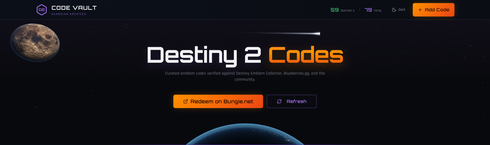

# Destiny 2 Code Vault 🔐

[](https://www.bungie.net/7/en/Destiny)
[](https://react.dev)
[](https://www.typescriptlang.org)
[](https://vitejs.dev)
[](LICENSE)

**Live:** [manaiakalani.github.io/destiny-code-finder](https://manaiakalani.github.io/destiny-code-finder/)

A privacy-focused Destiny 2 emblem code finder. The catalogue is reconciled against [Destiny Emblem Collector](https://destinyemblemcollector.com/availability/universalcode): **49 universal Destiny 2 emblems** (including the July 2026 Bungie Day set), plus cosmetics, Destiny 1 codes labelled separately, and restricted/expired entries.

<p align="center">
  
</p>

## ✨ Features

- **🔍 Curated Catalogue**: 79 hand-verified codes: 49 D2 emblems, 10 D2 cosmetics, 14 Destiny 1, 6 restricted/expired
- **🖼️ Official Emblem Previews**: Displays high-quality images directly from Bungie's CDN
- **⚡ Lightning Fast**: Built with Vite + React for instant page loads
- **🎨 Beautiful UI**: NASA-inspired "Deep Space" theme with Destiny 2 subclass colors
- **📱 Fully Responsive**: Works flawlessly on desktop, tablet, and mobile
- **🔒 Privacy-First**: No cookies, no accounts, and cookieless visit counts we run ourselves
- **🌙 Theme Support**: Dark, OLED, and Light modes
- **✨ Visual Effects**: Shooting stars, particle effects, and emblem shine animations

## 🚀 Quick Start

### Prerequisites

- [Node.js](https://nodejs.org) 18 or higher
- npm or yarn

### Installation

```bash
# Clone the repository
git clone https://github.com/Manaiakalani/destiny-code-finder.git
cd destiny-code-finder

# Install dependencies
npm install

# Start development server
npm run dev
```

The app will be available at **http://localhost:8080**

### Production Build

```bash
# Build for production
npm run build

# Preview production build locally
npm run preview
```

## 📁 Project Structure

```
destiny-code-finder/
├── .github/
│   └── workflows/         # GitHub Actions CI/CD
├── public/
│   ├── data/
│   │   └── emblems.json   # Emblem database (1000+ emblems)
│   └── emblems/           # Cached emblem images
├── scripts/
│   ├── scrape-emblems.js  # Bungie manifest scraper
│   └── download-emblems.js # Image downloader
├── src/
│   ├── components/        # React components
│   │   ├── ui/            # Base UI components
│   │   ├── CodeCard.tsx   # Emblem code card
│   │   ├── Header.tsx     # Navigation header
│   │   └── ...
│   ├── hooks/             # Custom React hooks
│   ├── pages/             # Route pages
│   ├── services/          # API & scraping services
│   └── types/             # TypeScript definitions
├── Dockerfile             # Production container
└── package.json
```

## 🛠️ Available Scripts

| Command | Description |
|---------|-------------|
| `npm run dev` | Start development server with HMR |
| `npm run build` | Create production build |
| `npm run preview` | Preview production build locally |
| `npm run lint` | Run ESLint |
| `npm run typecheck` | Type-check the app and the test suite |
| `npm run test:e2e` | Run the Playwright end-to-end suite |
| `npm run test:e2e:ui` | Run the end-to-end suite in Playwright's UI mode |
| `npm run verify:catalogue` | Check the code catalogue and emblem database are in parity |
| `npm run audit:ci` | Fail on any untriaged production `npm audit` advisory |
| `npm run discover:codes` | Report community codes missing from the catalogue |
| `npm run scrape:emblems` | Fetch latest emblem data from Bungie API |
| `npm run download:emblems` | Download and cache emblem images |

### End-to-End Tests

`npm run test:e2e` builds nothing on its own: run `npm run build` first, since the
suite is served from `dist` via `vite preview`. The specs cover appearance and the
localStorage rescue, migration, and quarantine paths that hold user-added codes.

```bash
npm run build
npx playwright install --with-deps chromium   # first run only
npm run test:e2e
```

### Discovering New Codes

`npm run discover:codes` checks community sources for emblem codes that are not yet
in `src/services/codeScraperService.ts` and prints them with links.

It never edits the catalogue. A Destiny code can only be redeemed once per account,
so an unverified entry costs a user a real redemption: every candidate is meant to
be confirmed against Bungie by hand before it is added.

```bash
npm run discover:codes            # human-readable report
npm run discover:codes -- --json  # machine-readable, used by the weekly workflow
```

Reddit rejects anonymous API requests, so that source is skipped unless
`REDDIT_CLIENT_ID` and `REDDIT_CLIENT_SECRET` are set (create a "script" app at
<https://www.reddit.com/prefs/apps>). The primary source needs no credentials.

### Running Emblem Scripts

The scrape scripts require a Bungie API key (free):

```bash
# Get your key at: https://www.bungie.net/en/Application
# Then run:
BUNGIE_API_KEY=your_key npm run scrape:emblems
```

## 🐳 Docker

### Build and Run

```bash
# Build the Docker image
docker build -t destiny-code-vault .

# Run the container (runs as non-root on port 8080)
docker run -p 8080:8080 destiny-code-vault
```

### Docker Compose

```yaml
version: '3.8'
services:
  destiny-code-vault:
    build: .
    ports:
      - "8080:8080"
    restart: unless-stopped
    read_only: true
    security_opt:
      - no-new-privileges:true
```

## 🎯 Data Sources

The app aggregates emblem codes from multiple sources:

| Source | Description |
|--------|-------------|
| **Reddit** | r/DestinyTheGame, r/destiny2, r/raidsecrets |
| **Blueberries.gg** | Community-verified emblem database |
| **Bungie API** | Official emblem images and metadata |
| **Curated List** | 49 D2 emblems + cosmetics, D1, and restricted codes |

## 🎨 Design System

The UI features a NASA-inspired "Deep Space" theme:

- **Primary**: NASA Blue (`#0b3d91`)
- **Accent**: Tech Cyan (`#4dd0e1`)
- **Success/Active**: Strand Green
- **Warning**: Solar Orange
- **Background**: Deep space gradient

### Destiny 2 Subclass Colors

- 🟣 **Void**: Purple (`#7c3aed`)
- 🟠 **Solar**: Orange (`#f97316`)
- 🔵 **Arc**: Cyan (`#06b6d4`)
- 🔷 **Stasis**: Ice Blue (`#38bdf8`)
- 🟢 **Strand**: Green (`#22c55e`)

## 🔒 Privacy

Code Vault is built with privacy as a core principle:

- ✅ No cookies
- ✅ No advertising profiles, cross-site tracking, or data selling
- ✅ Cookieless visit counts, on a counter we run
- ✅ No user accounts required
- ✅ Catalogue data stays in your browser
- ✅ Open source and auditable

See our [Privacy Policy](/privacy) for complete details.

## 🤝 Contributing

Contributions are welcome! Please read our [Contributing Guidelines](CONTRIBUTING.md) before submitting a pull request.

### Quick Contribution Guide

1. Fork the repository
2. Create a feature branch (`git checkout -b feature/amazing-feature`)
3. Commit your changes (`git commit -m 'Add amazing feature'`)
4. Push to the branch (`git push origin feature/amazing-feature`)
5. Open a Pull Request

## 📄 License

This project is licensed under the MIT License - see the [LICENSE](LICENSE) file for details.

## ⚠️ Disclaimer

This project is not affiliated with, endorsed by, or connected to Bungie, Inc. Destiny 2, the Destiny Logo, and related marks are trademarks of Bungie, Inc.

Emblem codes are aggregated from publicly available community sources. Always verify codes at the [official Bungie redemption site](https://www.bungie.net/7/en/Codes/Redeem) before use.

## 🙏 Acknowledgments

- [Bungie](https://www.bungie.net) for creating Destiny 2
- [Blueberries.gg](https://www.blueberries.gg) for maintaining emblem databases
- [Destiny Emblem Collector](https://destinyemblemcollector.com) for the authoritative universal code list
- [Mijago's Rewards](https://rewards.mijago.net) for cross-referenced emblem data
- The Destiny 2 Reddit community for sharing codes
- All Guardians who contribute to keeping the community informed

## Updates

**November 2026.** The page is the Tower at night: the Moon over an Earth limb, stars, and the occasional meteor. The cards keep the glitch codes. Light mode is a dusk slate, and the hero stays night. A phone shows the catalogue before the sky. About opens on the night page, at the title. About, Privacy, and a missing page share the footer. Visit counts are on again. The list was last checked on 19 November 2026.

**August 2026.** The catalogue matches Destiny Emblem Collector, including the Bungie Day emblems. Destiny 1 codes are labelled on their own. Redeem opens as a normal link.

**Earlier.** Emblem names were corrected against the public lists, codes that were never universal were dropped, and Add Code accepts only the Bungie character set.

---

Made with ♥ in Seattle, WA for the Destiny 2 community

**Eyes up, Guardian.** 👁️

